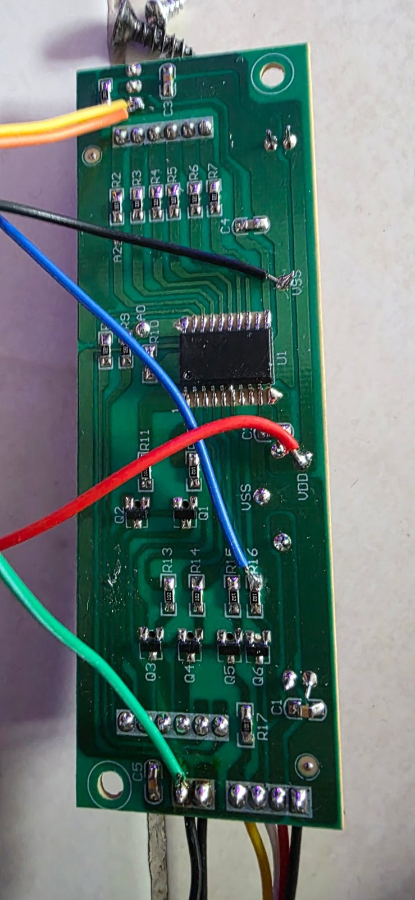
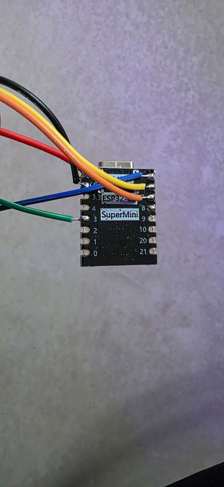
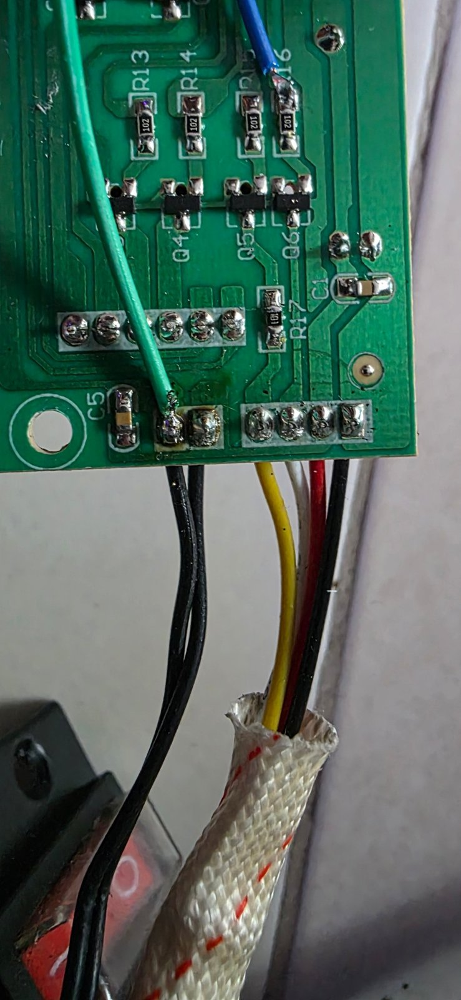
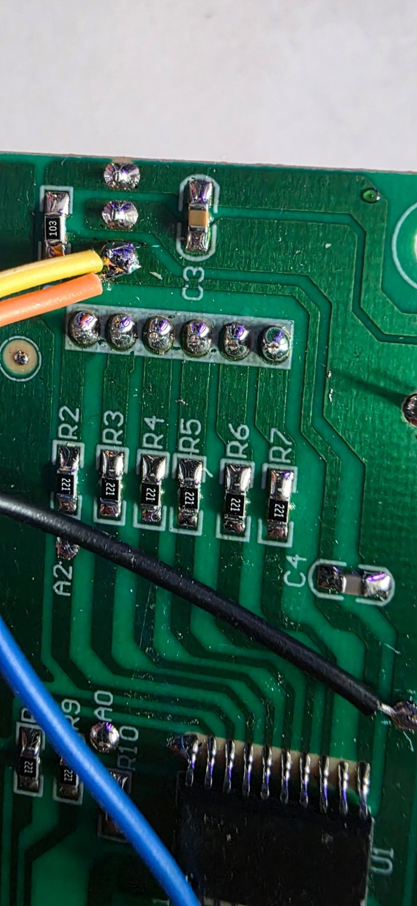
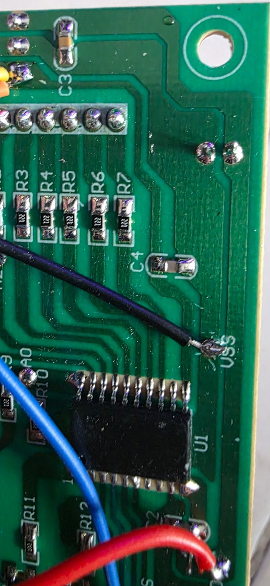
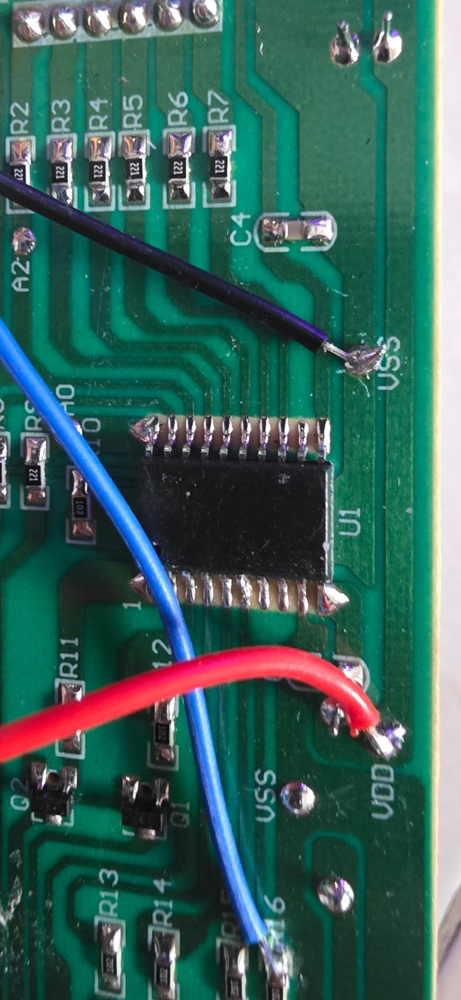
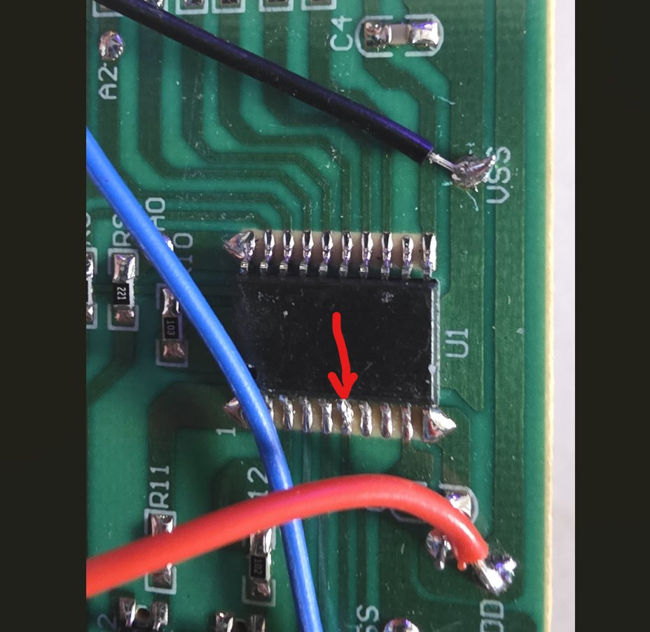

# Blumfeldt (Klarstein) Cosmic Beam → ESPHome smart heater

Turn the **non-smart** (remote-only) Blumfeldt (Klarstein) Cosmic Beam infrared heater into a local
Home Assistant thermostat with an **ESP32-C3 Super Mini** and ESPHome — no cloud, no Tuya.

What you get:

- `climate` entity in Home Assistant (Heat / Off, target temperature)
- Room temperature from the heater's **own NTC sensor** (no extra sensor needed)
- The heater's **original LED display keeps working** and follows Heat / Off
- Safety logic on the ESP itself: starts **Off** after every boot or power cut, max 3 h
  continuous heating, sensor-fault cutoff, Off if Home Assistant is unreachable for 5 min
- **Reversible:** the only change to the original board is one trace cut. If you cut it
  cleanly, a solder bridge puts the heater back to stock — see
  [Reverting the conversion](#reverting-the-conversion)

> ⚠️ **This is a mains-powered 2.4 kW heater.** You are modifying it at your own risk.
> Read the [Safety](#safety) section before you start. This guide documents one working
> conversion on one board revision — yours may differ. Measure before you cut or solder.

---

## Contents

1. [Which heater / board this covers](#1-which-heater--board-this-covers)
2. [How the original board works](#2-how-the-original-board-works)
3. [Parts and tools](#3-parts-and-tools)
4. [Safety](#safety)
5. [Step 1 — Flash the ESP32-C3 (on your desk)](#step-1--flash-the-esp32-c3-on-your-desk)
6. [Step 2 — Verify the board with a multimeter](#step-2--verify-the-board-with-a-multimeter)
7. [Step 3 — Disconnect U1 from the relay transistor](#step-3--disconnect-u1-from-the-relay-transistor)
8. [Step 4 — Wire the ESP32-C3](#step-4--wire-the-esp32-c3)
9. [Photos of the finished build](#photos-of-the-finished-build)
10. [Step 5 — First power-up and tests](#step-5--first-power-up-and-tests)
11. [Calibrating the temperature sensor](#calibrating-the-temperature-sensor)
12. [How the display sync works](#how-the-display-sync-works)
13. [Reverting the conversion](#reverting-the-conversion)
14. [Known limitations](#known-limitations)
15. [Troubleshooting](#troubleshooting)

---

## 1. Which heater / board this covers

| Item | Value |
|---|---|
| Heater | Blumfeldt (Klarstein) Cosmic Beam, **non-smart** version (IR remote only) |
| Display / control board | Marked **`ZD-90F PCB V1.2 THC-B 2020/4/5`** (black front, green back) |
| Original controller | **U1**, 20-pin SOP chip with a sticker (`0106E1 GY-24H` on this unit) |
| Connector to power board | **4-pin** (black, red, white, yellow) + **2-pin** (temperature sensor) |

The **smart** (Tuya) version uses a different board (`CC939-V1.1` with a TYWE3S Wi-Fi
module) and is **not** covered here — it already works locally with
[tuya-local](https://github.com/make-all/tuya-local).

If your board looks different, use the measurement steps below to map it before changing
anything.

---

## 2. How the original board works

All values below were measured on the unit this guide is based on.

### 4-pin cable (display board ↔ power board)

| Wire | Function | Measured |
|---|---|---|
| **Black** | GND (beeps with the `VSS` pad) | — |
| **Red** | +5 V supply for the display board (beeps with the `VDD` pad) | 4.98 V |
| **White** | **Main relay** — pulled to GND by transistor **Q6** when the heater is ON | ~17 V off / **0 V on** |
| **Yellow** | Second output (via **R17** 100 Ω → **Q5**). Never switched in normal use on this unit | ~17 V |

- The relays sit on the power board and are fed from an **unregulated ~17 V rail**
  (drops to ~12 V under relay load). **Never connect white, yellow or that rail to the ESP.**
- Chain for the heating relay: **U1 pin → R16 (1 kΩ) → Q6 base → Q6 collector → white wire**.
  When U1 drives that pin high, Q6 pulls white to GND and the relay switches on.
- After mains power returns the original firmware always starts in **standby** (that's why
  a smart plug alone can't switch these heaters on).

### 2-pin temperature sensor (NTC)

```
+5 V (VDD) ── NTC ──┬── to U1 analog input   ← "upper" pin, next to C5
                    ├── C5 (filter)
                    └── R10 (10 kΩ) ── GND
```

- Measured **2.0 V** at the middle point at room temperature → NTC ≈ 13–15 kΩ there.
- The sensor sticks out of the heater housing and measures **room temperature**.

### IR receiver

- 3-leg IR receiver at the opposite end of the board (OUT / GND / VCC). Find OUT with
  continuity: one leg beeps with VSS, one with VDD, the remaining one is **OUT**.
- OUT has only a **weak pull-up**: short-circuit current OUT → VSS measured **0.06 mA**,
  so an ESP32 pin can listen to it and pull it low directly.
- The remote's power button is a **toggle**: NEC, **address `0xFF00`, command `0xAD52`**.

### Display

After switching ON, the LED display shows U1's own **set temperature for ~5 s**, then the
**room temperature** from the NTC.

---

## 3. Parts and tools

| Part | Notes |
|---|---|
| ESP32-C3 Super Mini | Any ESP32-C3 board works; GPIOs below assume the Super Mini |
| Thin silicone wire | ~10 cm pieces |
| Multimeter | Continuity, DC volts, DC mA |
| Soldering iron, sharp hobby knife | For the trace cut |
| Kapton tape / heat-shrink | Insulation |
| *(recommended)* 10 kΩ resistor | GPIO5 → GND pull-down, see [limitations](#known-limitations) |

---

## Safety

- **Always unplug the heater** before opening it, cutting or soldering.
- **Never connect USB to the ESP while the heater is plugged into the mains.** The ESP is
  powered from the heater's 5 V rail; USB would tie two supplies together and connect your
  PC's ground to the heater electronics. Isolation of the heater's low-voltage side from
  mains was **not verified** — treat it as live.
- After installation, update the ESP **only over Wi-Fi (OTA)**.
- For live measurements: one hand, probe only the points listed, stay away from the power
  board.
- Mount the ESP away from the heating element, behind the plastic display window
  (the metal chassis blocks Wi-Fi — see [Wi-Fi inside the metal chassis](#wi-fi-inside-the-metal-chassis)).
  Keep the housing's IP44 seals intact.
- Don't leave the heater unattended until you've tested every safety function below.

---

## Step 1 — Flash the ESP32-C3 (on your desk)

1. In Home Assistant install the **ESPHome Device Builder** app
   (Settings → Apps → App Store → ESPHome Device Builder).
2. Create a new device, board **ESP32-C3 Super Mini**.
3. Replace the generated YAML with [`cosmic-beam.yaml`](cosmic-beam.yaml) from this repo.
   Adjust the `substitutions:` block (name, friendly name).
4. Add the secrets listed in [`secrets.yaml.example`](secrets.yaml.example) via the
   builder's **Secrets** editor. Generate your own API key (the builder creates one for a
   new device) and a hotspot password.
5. First install over USB: **Install → Manual download → Factory format**, then flash the
   `.factory.bin` at address **`0x0`**:

   ```bash
   esptool --chip esp32c3 -p <PORT> -b 460800 write-flash 0x0 <name>.factory.bin
   ```

   Windows/WSL users: pass the USB device into WSL with
   [usbipd-win](https://github.com/dorssel/usbipd-win), or use the browser flasher /
   "Plug into this computer" option of the builder.

6. Check the device appears in Home Assistant, then unplug USB. All later updates go
   **Install → Wirelessly**.

> **Re-using an ESP32-C3 from another project?** If esptool refuses `--erase-all` with
> *"Active security features detected"* and the board boot-loops after flashing, hold
> **BOOT**, replug (download mode), then run
> `esptool --chip esp32c3 -p <PORT> erase-flash --force` and flash again.

> **Wi-Fi fails with `reason='Auth Expired'`?** Common on ESP32-C3 Super Mini boards.
> The config already contains the fix: `output_power: 8.5dB`.

---

## Step 2 — Verify the board with a multimeter

Before cutting anything, confirm your board matches [section 2](#2-how-the-original-board-works):

**Heater unplugged (continuity):**
- Black wire ↔ `VSS` pad beeps; red wire ↔ `VDD` pad beeps.
- White wire ↔ **Q6's single-side pad** (collector) beeps.
- **R16** sits next to Q6: one end goes to Q6's base, the other end goes to a U1 pin.

**Heater plugged in, original board connected (DC volts, black probe on VSS):**
- Red ≈ 5 V.
- White ≈ 17 V in standby, **0 V** when switched ON with the remote.

If white doesn't behave like this, **stop** — your board differs.

---

## Step 3 — Disconnect U1 from the relay transistor

Only **one cut** is needed. U1 stays on the board and keeps driving the display.

```
U1 pin ──✂── trace ── R16 (1 kΩ) ── Q6 base
            └─ GPIO5 goes here (R16's U1-side pad)
```

1. Heater unplugged. Find the U1 pin that connects to the **U1-side end of R16**
   (continuity).
2. Cut the trace between that U1 pin and R16 (two knife cuts ~1 mm apart, remove the copper
   between), or lift that single U1 leg.
3. Check: R16's U1-side pad must **no longer** beep with that U1 pin; R16 must still be
   connected to Q6.

> **Keep it reversible:** make the cut narrow and clean, and don't scrape into the pads
> on either side, so the gap can later be bridged again with solder or a short wire
> (see [Reverting the conversion](#reverting-the-conversion)).

> **About the photo of the cut:** the cut on the original unit is very clean, so in
> [photo 7](#photos-of-the-finished-build) it is hard to see that the leg is separated at
> all — but it **is** cut, and continuity confirms it. Don't rely on looks: always check
> with the multimeter that R16's U1-side pad no longer beeps with the U1 pin.

Optional test before soldering the ESP: plug the heater in and switch it ON with the remote —
the display shows ON, but **no relay click and no heat** (white stays ~17 V). U1 is now out
of the loop.

---

## Step 4 — Wire the ESP32-C3

Heater unplugged, ESP **not** on USB.

| Display board point | ESP32-C3 Super Mini | Purpose |
|---|---|---|
| `VDD` pad (+5 V) | **5V** | Power |
| `VSS` pad (GND) | **G** | Ground |
| **R16, U1-side pad** (where you cut) | **GPIO5** | Heater relay via Q6 |
| NTC connector **upper pin** (next to C5) | **GPIO3** | Temperature (listen only) |
| IR receiver **OUT** leg | **GPIO6** | Send the power code to U1 (display sync) |
| IR receiver **OUT** leg | **GPIO7** | Listen for remote presses (optional) |

Recommended: **10 kΩ from GPIO5 to G** (keeps the relay off while the ESP boots).

Nothing else needs cutting: GPIO3 and GPIO7 only listen, so U1 keeps reading the sensor and
the IR receiver exactly as before. GPIO6 is configured open-drain and only ever pulls OUT low.

Insulate everything, fix the ESP behind the plastic display window, away from the element.

### Wi-Fi inside the metal chassis

The heater has a **metal chassis**, and that includes the compartment holding the control
board, the LED display and the ESP32-C3 Super Mini. Metal around the ESP shields its tiny
on-board antenna, so the **Wi-Fi signal can be weak** once the case is closed — even if it
was fine on the bench. Plan for some tuning during assembly:

- **Check the signal before closing the case.** Assemble loosely, power the heater, and
  watch the Wi-Fi signal in the ESPHome logs (`Signal strength: -xx dB`). Close the case
  and check again: around −70 dB or better is fine, worse than about −80 dB means
  dropouts. Adding a `wifi_signal` sensor to the config makes this easy to track in
  Home Assistant.
- **Reposition the ESP.** Put the antenna end of the board (the end opposite the USB-C
  socket) as close as possible to the plastic display window or any other non-metal
  opening, and keep it off the metal walls — a few millimetres of spacing already helps.
- **Antenna tuning / external antenna.** If repositioning isn't enough, use an ESP32-C3
  board with a u.FL connector and a small external antenna routed to the plastic window,
  or (for the experienced) modify the Super Mini's antenna. Some Super Mini boards also
  work better with `output_power` raised from 8.5 dB — test a few values; too high can
  cause the "Auth Expired" resets described in Step 1.
- **Move the access point closer** or add one near the heater if the signal stays marginal.

A weak signal is not dangerous: if the ESP loses Home Assistant for more than 5 minutes it
switches the heater **Off**. But frequent dropouts make the heater turn off unexpectedly.

---

## Photos of the finished build

Wire colours used on the original unit:

| Wire | Display board | ESP32-C3 |
|---|---|---|
| Black | `VSS` | **G** |
| Red | `VDD` (+5 V) | **5V** |
| Blue | R16, U1-side pad | **GPIO5** |
| Green | NTC connector upper pin (next to C5) | **GPIO3** |
| Yellow | IR receiver OUT | **GPIO6** |
| Orange | IR receiver OUT | **GPIO7** |

**1. Back of the display board, all wires connected**



**2. ESP32-C3 Super Mini side** — black/red on G/5V, blue/yellow/orange on GPIO5/6/7,
green on GPIO3



**3. R16 / Q6 (blue wire) and the NTC connector (green wire on the upper pin, next to C5)**
— the 4-wire cable to the power board (yellow, white, red, black) is on the right



**4. IR receiver tap** — yellow (GPIO6) and orange (GPIO7) both on the receiver's OUT pad



**5–6. U1, with the `VSS` (black) and `VDD` (red) wires**

 

**7. The cut U1 leg (red arrow)**



> The cut is very clean, so in this photo it is hard to see that the leg is actually
> separated — but it **is** cut, 100 %. On your own board, confirm the cut with continuity
> (R16's U1-side pad must not beep with that U1 pin), not by eye.

---

## Step 5 — First power-up and tests

1. Plug the heater into the mains (no USB on the ESP). The device comes online in Home
   Assistant within ~1 minute; the display is in standby.
2. **Temperature:** "Heater sensor temperature" shows a plausible room value
   (see [calibration](#calibrating-the-temperature-sensor)).
3. **Heat:** set mode **Heat** with a target above room temperature → relay clicks, heater
   warms, display switches **ON**.
4. **Off:** relay clicks off, display goes to **standby**.
5. **Safety checks — do all of them:**
   - Restart the ESP from Home Assistant while heating → it must come back **Off**.
   - Unplug the heater for 5 s while heating, plug back in → **Off**, display standby.
   - Stop Home Assistant / Wi-Fi for > 5 min while heating → heater switches **Off**.
   - Warm the NTC (e.g. breath / hair dryer) past ~31.5 °C → heater forced **Off**.

---

## Calibrating the temperature sensor

The config models the NTC with **B = 3950** and **13 kΩ at 20 °C**, calibrated on the
original unit against a reference thermometer. Your sensor may differ.

1. Put a reference thermometer next to the heater's sensor for 30 min (heater Off).
2. If the ESP reads differently, note its reading. With the current calibration the ESP's
   reading tells you the sensor's resistance; set that resistance as `reference_resistance`
   at the reference temperature. Example from this build: ESP showed 24.1 °C with
   `15 kΩ @ 21 °C` while the room was 20 °C → changed to `13 kΩ @ 20 °C`.

The sensor runs on 5 V and the ESP32-C3's ADC tops out around 2.5 V, so readings **clip at
about 32 °C**. Fine for room temperature; the config forces the heater Off above 31.5 °C.

---

## How the display sync works

U1's only input is the IR receiver, and the power button is a toggle. So the ESP:

- injects the power code (`NEC 0xFF00 / 0xAD52`) into the receiver's OUT line whenever the
  thermostat changes between **Heat** and **Off** (reaching the target does **not** send
  anything — the display stays ON while the thermostat idles);
- remembers whether U1 is ON (stored across restarts);
- knows that after a **mains power cut** U1 always starts in standby (it checks the ESP's
  reset reason);
- optionally listens on GPIO7, so a press on a real remote is tracked too;
- exposes a **"Display: resync"** button in case the display ever ends up inverted.

The number on the display is U1's own reading — U1's set temperature is shown for ~5 s
after switching ON and no longer controls anything.

---

## Reverting the conversion

The conversion is **reversible if you cut the U1 trace cleanly**. Nothing else on the
original board is modified: the other ESP wires are only soldered to existing pads and
listen-only points.

1. Heater unplugged. Desolder the ESP wires from the `VDD`, `VSS`, R16, NTC and IR
   receiver points.
2. Close the cut: bridge the gap between the U1 pin and R16's U1-side pad with a blob of
   solder or a short piece of thin wire. If you lifted the U1 leg instead, resolder it to
   its pad.
3. Check with the multimeter: R16's U1-side pad must **beep with that U1 pin** again.
4. Plug the heater in and test with the original remote: ON gives a relay click and heat,
   OFF switches it off, and the display behaves as before.

A rough cut (copper torn up, pads damaged, or a pin bent or broken off) is harder to
undo; in that case use a short wire from the U1 pin to the R16 pad.

---

## Known limitations

- **No hardware pull-down on GPIO5** unless you add the 10 kΩ: the relay may click briefly
  while the ESP boots.
- **GPIO3 is wired directly** to the NTC divider. If the two sensor wires were ever shorted,
  5 V would reach GPIO3. A 10 kΩ series resistor removes that risk.
- **Temperature clips at ~32 °C** (see above).
- **Wi-Fi range is reduced** by the heater's metal chassis; antenna placement matters
  (see [Wi-Fi inside the metal chassis](#wi-fi-inside-the-metal-chassis)).
- **Heating power levels** of the original remote aren't reproduced — the ESP switches the
  main relay on/off only. (The yellow line was never switched by U1 in testing.)
- The display's 5-second set-temperature flash shows U1's stored value, not Home Assistant's
  target. Syncing it would need the remote's "+"/"−" codes.
- The heater only heats while the ESP has a valid sensor reading; by default it also switches
  Off when Home Assistant is unreachable for 5 minutes (remove the `interval:` block if you
  want it to keep regulating on its own).

---

## Troubleshooting

| Symptom | Cause / fix |
|---|---|
| Relay never clicks, ESP shows "Heating" | Measure R16's ESP-side pad: should be ~3.3 V while heating. 0 V → wrong pin / wire, or U1 still connected. |
| Relay only clicks the first time | Thermostat minimum times. This config uses 5 s; earlier versions used 3 min. |
| Heater heats regardless of the ESP | U1 still connected to R16 (cut on the wrong side), or a solder bridge on Q6 / the white line. Unplug and check with continuity. |
| Display inverted (ON when Off) | Press **Display: resync** once. |
| Temperature ~4 °C off | Recalibrate (see above). |
| ESP boot-loops right after flashing a used board | Flash encryption / old firmware — `erase-flash --force` in download mode, then flash again. |
| Wi-Fi `Auth Expired` | `output_power: 8.5dB` (already in the config). |
| Works on the bench, drops off once the case is closed | Metal chassis shielding — reposition the ESP's antenna end toward the plastic display window, see [Wi-Fi inside the metal chassis](#wi-fi-inside-the-metal-chassis). |

---

## License

MIT — see [LICENSE](LICENSE). No affiliation with Blumfeldt (Klarstein) / Chal-Tec. Brand names are
used only to identify the hardware.
